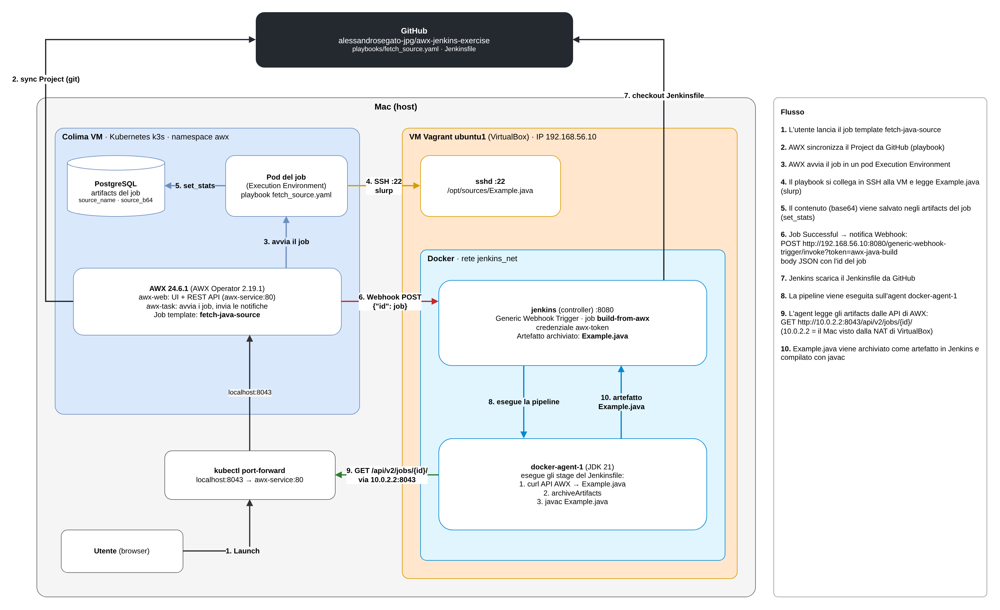

# awx-jenkins-exercise

Esercizio di integrazione tra **AWX** e **Jenkins**: AWX preleva un sorgente Java da una VM, avvisa Jenkins con un webhook, e Jenkins crea un artefatto con il file e lo compila.

## Obiettivi dell'esercizio

1. Creare un Job Template AWX che preleva da una VM un file (`Example.java`).
2. Creare un webhook su AWX che si interfaccia con Jenkins, creando un artefatto con il file prelevato.
3. Triggerare da AWX una pipeline Jenkins che usa l'artefatto per una build (`javac Example.java`).
4. Il `Jenkinsfile` della pipeline viene preso da GitHub.

## Architettura



Il passaggio tramite gli **artifacts del job** è necessario perché AWX esegue i playbook dentro un container temporaneo: un file copiato lì sparirebbe alla fine del job. Gli artifacts invece restano salvati nel database di AWX e sono leggibili tramite API.

## Contenuto del repository

| File | Usato da | Cosa fa |
|---|---|---|
| `playbooks/fetch_source.yaml` | AWX (Project) | Controlla che il file esista sulla VM, lo legge con `slurp` e lo salva negli artifacts del job con `set_stats` |
| `Jenkinsfile` | Jenkins (Pipeline script from SCM) | Riceve il webhook, scarica il file dalle API di AWX, lo archivia come artefatto e lo compila |

## Configurazione

### Ambiente

- **AWX** installato su Kubernetes (k3s di Colima) con AWX Operator 2.19.1.
  - Risorse ridotte (`*_resource_requirements`) per farlo girare su un Mac con 8 GB di RAM.
- **VM Vagrant** `ubuntu1` con IP privato `192.168.56.10`, porte 8080 e 50000 inoltrate sul Mac.
- **Jenkins** in Docker sulla VM, con l'agent `docker-agent-1` sulla rete Docker `jenkins_net` (collegato al controller con `http://jenkins:8080`).

### AWX

| Risorsa | Nome | Impostazioni |
|---|---|---|
| Credential | `vagrant-ubuntu1` | Tipo Machine, utente `vagrant`, chiave privata di Vagrant, escalation `sudo` |
| Inventory | `lab` | Host `ubuntu1` con `ansible_host: 192.168.56.10` |
| Project | `awx-jenkins-exercise` | Git, questo repository, branch `main` |
| Job Template | `fetch-java-source` | Inventory `lab`, playbook `playbooks/fetch_source.yaml`, credential `vagrant-ubuntu1` |
| Notification | `jenkins-build` | Tipo Webhook, `POST` su `http://192.168.56.10:8080/generic-webhook-trigger/invoke?token=awx-java-build`, header `Content-Type: application/json` |

La notifica è collegata al job template sull'evento **Success**.

### Jenkins

- Plugin **Generic Webhook Trigger** installato.
- Credenziale **Secret text** con ID `awx-token`: token OAuth di AWX con scope *Read*, usato per leggere gli artifacts dei job.
- Job **`build-from-awx`** di tipo Pipeline, *Pipeline script from SCM*: Git, questo repository, branch `*/main`, script path `Jenkinsfile`.

### Indirizzi usati

| Da | Verso | Indirizzo |
|---|---|---|
| AWX | VM (SSH) | `192.168.56.10:22` |
| AWX | Jenkins (webhook) | `http://192.168.56.10:8080` |
| Jenkins (agent nella VM) | API di AWX | `http://10.0.2.2:8043` (`10.0.2.2` è il Mac visto dalla rete NAT di VirtualBox, dove è attivo il port-forward di AWX) |
| Browser sul Mac | AWX / Jenkins | `http://localhost:8043` / `http://localhost:8080` |

## Come eseguirlo

1. Avviare l'ambiente:
   ```bash
   colima start
   kubectl port-forward svc/awx-service -n awx 8043:80
   ```
   e, in un altro terminale, dalla cartella del progetto Vagrant:
   ```bash
   vagrant up ubuntu1
   ```
2. In AWX lanciare il job template **`fetch-java-source`**.
3. A job concluso (**Successful**), in Jenkins parte da sola una build di **`build-from-awx`**.
4. Nella build si vedono:
   - la causa `Generic Cause` (avviata dal webhook);
   - il contenuto di `Example.java` stampato nel log;
   - l'artefatto `Example.java` archiviato;
   - la compilazione `javac Example.java` terminata con `SUCCESS`.